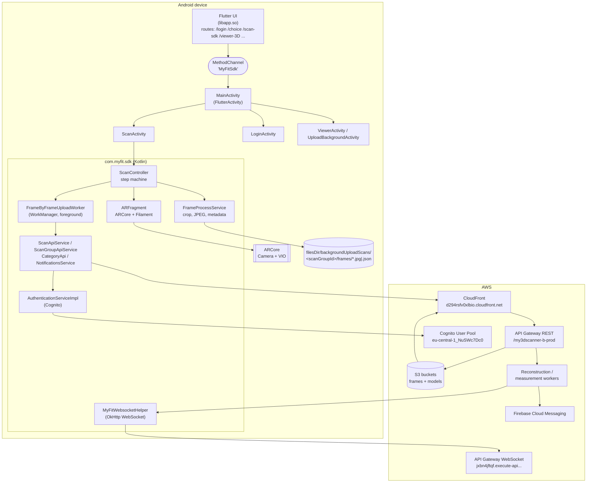
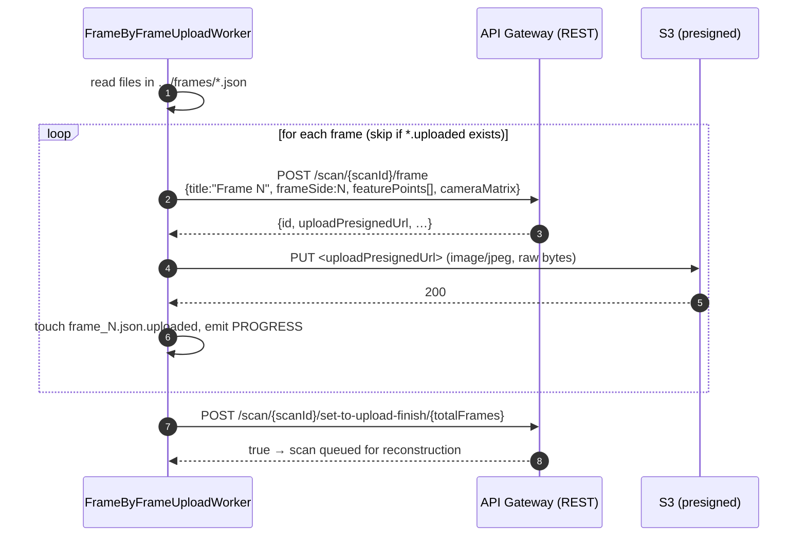
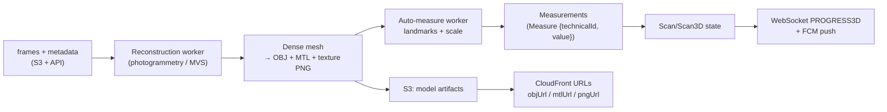
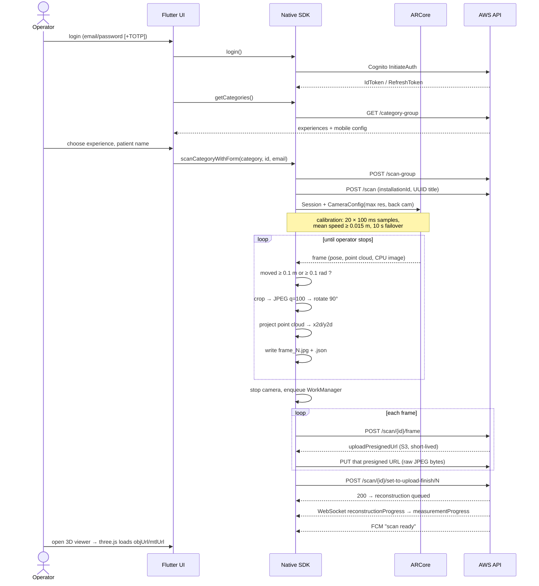

# My3D Scanner (`fr.myned.my3dScanner`) — Architecture & Reverse-Engineering Report

**Target:** `fr.myned.my3dScanner` — "My3D scanner - 3D body scan" by MyFit Solutions / MYNED CORPORATION
**Version analysed:** `26.8.11` (versionCode `301`), XAPK 53.7 MB, `minSdk 31` (Android 12), `targetSdk 36`
**Artefact:** `apk/my3d.xapk` → `fr.myned.my3dScanner.apk` + `config.arm64_v8a.apk` (native libs)
**Build fingerprints:** Flutter **Dart 3.9.2 (stable)** AOT, ARCore SDK, Google Filament, split APK (arm64-v8a + xxhdpi)

> Method: static analysis only. XAPK pulled from APKPure, `apktool`/`unzip` for resources,
> **JADX 1.5.3** for DEX → Java, **Blutter** for the Dart AOT snapshot (`libapp.so`, ARM64),
> plus string/asset mining. No account was created, no request was sent to the vendor's backend.
> Everything below is either **Observed** (read from the binary) or **Inferred** (reasoned, not proven).

> **Companion document:** [`code-capture-calibration.md`](./code-capture-calibration.md) quotes the actual
> implemented code for camera setup, calibration, frame triggering, JPEG encoding and 3D→2D projection
> (verbatim decompiled Java, plus 3 clearly-marked reconstructions).

**Contents:** 1 TL;DR · 2 Stack · 3 Component map · 4 Flutter↔native bridge · 5 Backend contract ·
6 Camera pipeline (**6.4 calibration**, **6.5 when a photo is taken**, **6.6 ARCore frame → JPEG**,
**6.10 sensors**, **6.11 JPEG anatomy**, **6.12 JSON vs wire payload**, **6.13 scenario matrix**) ·
7 Upload & data inventory · 8 Server pipeline · 9 Sequence · 10 Design rationale · 11 Confidence & verification · 12 Summary

---

## 1. TL;DR

* The app is **a thin Flutter UI wrapped around a native Android "MyFit SDK"** (`com.myfit.sdk`, Kotlin).
  Flutter never talks to the network for scanning — all capture and HTTP lives in the native layer,
  bridged through one `MethodChannel` named **`MyFitSdk`**.
* 3D capture is **ARCore-based photogrammetry**, not a depth-sensor scan:
  ARCore gives **camera poses + sparse 3D feature points**, the app grabs **JPEG stills** at intervals,
  and each still is shipped with its **2D↔3D correspondences and the camera pose**.
  Exact sensor list, pixel content and JSON/bodies: **§6.10–6.13** and **§6.12**.
* The "scan" itself is a **server-side reconstruction job**. The phone only produces
  `frame_1.jpg … frame_N.jpg` plus per-frame metadata; the cloud builds the OBJ/MTL/PNG model
  and the measurements, and the app is notified over a WebSocket / FCM.
* Backend is **AWS**: CloudFront → API Gateway (REST + WebSocket) → Lambda/containers,
  **Cognito** for identity, presigned **S3 PUT** URLs for the images.
* Two independent deployments: **Europe (`eu-central-1`)** and **North America (`us-east-1`)**, chosen once at first launch.
* The 3D viewer in the app is mundane: a **WebView running three.js** that loads `.obj` + `.mtl` + texture from CloudFront.

---

## 2. Technology stack (observed)

| Layer | Technology | Evidence |
|---|---|---|
| UI shell | **Flutter** (Dart 3.9.2 AOT), `go_router`-style named routes, `flutter_translate`, `flutter_dotenv` | `libapp.so`, `assets/flutter_assets/assets/translations/{en,fr}.json` |
| App logic | **Kotlin**, AndroidX, `com.myfit.sdk` (~434 classes) | `com/myfit/sdk/**` |
| Camera / tracking | **ARCore** (`libarcore_sdk_c.so`, `libarcore_sdk_jni.so`) | `com/myfit/sdk/utils/arcore/ArCore.kt` |
| 3D rendering on phone | **Google Filament** + `gltfio` (camera background / AR overlay) | `libfilament-jni.so`, `libgltfio-jni.so` |
| 3D viewer | **three.js** in a WebView, local `assets/www` | `assets/www/{three.min.js,OBJLoader.js,MTLLoader.js,OrbitControls.js,script.js}` |
| HTTP | **OkHttp 3** + **Jackson** databind | `com/myfit/sdk/services/BaseApiService.kt` |
| Background jobs | **WorkManager** `CoroutineWorker` (frame upload, zip upload) | `com/myfit/sdk/upload/*` |
| Auth | **AWS Cognito** (USER_PASSWORD_AUTH, NEW_PASSWORD_REQUIRED, TOTP/SMS MFA, refresh tokens, OAuth2 hosted-UI code exchange) | `AuthenticationServiceImpl.kt`, `models/request/Cognito*` |
| Push | **Firebase Cloud Messaging** + Crashlytics | `MyFitNotificationService.kt`, `firebase_*` |
| Image codec | Android `YuvImage.compressToJpeg`, `Bitmap` rotate, JPEG q=100 | `RawImageProcessor.kt` |

---

## 3. High-level component map



---

## 4. Runtime shell: Flutter ↔ native bridge

`fr/myned/my3dScanner/MainActivity.kt` registers exactly one channel:

```kotlin
MethodChannel(flutterEngine.dartExecutor.binaryMessenger, "MyFitSdk")
```

Methods exposed to Dart:

| Method | Args | What it does |
|---|---|---|
| `settings` | map (`apiBaseHost`, `wsUrl`, `endpoint`, `region`, `poolId`, `appId`, colours, `loginLogo`) | Applies `.env` + theme to the native SDK, returns `"ok"` |
| `getCategories` | — | `GET /category-group` → returns the list of **scan experiences** (JSON) to Dart |
| `login` | — | Opens `LoginActivity` (native Cognito screen), result via `startActivityForResult` |
| `scanCategoryWithForm` | `category` (ScanExperience JSON), `id`, `email` | Stores the "patient" fields, opens `ScanActivity` |
| `startScanWithCategory` | `category` | Opens `ScanActivity` |
| `viewer3D` | — | Opens `ViewerActivity` (WebView three.js) |
| `backgroundUpload` | — | Opens the uploads screen |

Callbacks Flutter exposes back to Android (Dart side, `sdkChannelMethods.dart`):
`login`, `getCategories`, `scanCategoryWithForm`, `backgroundUpload`, `viewer3D`.
Native → Dart events: `onBackgroundUploadScanUploadProgressed`, and result strings
(`LoginAbort`, `LoginExit`, `CustomAuthentication`, `viewerExit`, `viewerError`, `backgroundUploadExit`).

**Consequence:** the Dart layer is *presentation only*. `.env` files are shipped in clear text and
the SDK is a self-contained library — the interesting behaviour is all in `com.myfit.sdk`.

### 4.1 Bundled environment configuration (observed, verbatim)

`assets/flutter_assets/assets/config/prod.env`:

```ini
API_BASE_URL=https://d294rsfv0xlbio.cloudfront.net/my3dscanner-b-prod
API_WS_URL=wss://jxbn4jftqf.execute-api.eu-central-1.amazonaws.com/my3dscanner-b-prod/
API_ENDPOINT=/my3dscanner-b-prod
COGNITO_REGION=eu-central-1
COGNITO_POOL_ID=eu-central-1_NuSWc7Dc0
APP_ID=7pnhs3o5clvts4qs7d8335r3ds

# North America
US_API_BASE_URL=https://doimyi0k2jl5t.cloudfront.net/my3dscannerusa-b-prod
US_API_WS_URL=wss://uezrez1om2.execute-api.us-east-1.amazonaws.com/my3dscannerusa-b-prod
US_COGNITO_REGION=us-east-1
US_COGNITO_POOL_ID=us-east-1_BzZLMvJjr
US_APP_ID=319f5kt0hscl8osqnedlf4bgbg
```

There is also `preprod.env` (`…cloudfront.net/prod`, `…-b-preprod` endpoints, separate pools).
The **app secret** (`APP_ID`) is a Cognito app client id, not a secret in the AWS sense,
but it is a fixed public credential that lets anyone drive the login endpoint.

Requests are built as `baseURL + path`, so the effective EU REST base is
`https://d294rsfv0xlbio.cloudfront.net/my3dscanner-b-prod/scan/...`.

`region.txt` / `users.txt` in the app (`utils/ioFilesService.dart`) are local scratch files for the
region choice and cached user, not network paths.

---

## 5. Backend contract

### 5.1 REST endpoints (observed from request classes)

| Method | Path | Body / params | Returns |
|---|---|---|---|
| `POST` | `/scan-group` | `{title, categoryGroupId, signInUserEmail, firstName, lastName, email, metadata}` | `ScanGroupAPIModel` (`id`, `title`, `scans[]`, `categoryGroup`, …) |
| `POST` | `/scan` | `{title, categoryId, categoryGroupId, scanGroupId, installationId}` | `ScanAPIModel` (`id`, `currentState`, `category`, …) |
| `POST` | `/scan/{scanId}/frame` | `{title:"Frame N", frameSide:N, featurePoints:[{x,y,z,x2d,y2d}…], cameraMatrix:[[…4×4…]]}` | `FrameAPIModel` (`id`, `uploadPresignedUrl`, `cameraMatrix`, `frameSide`, `isLandscape`, `currentState`, `creationDate`) |
| `PUT` | *(`uploadPresignedUrl`)* | **raw JPEG** `image/jpeg` | 200 (S3) |
| `POST` | `/scan/{scanId}/set-to-upload-finish/{totalFrames}` | empty | `true` |
| `GET` | `/scan/upload-background/refresh/{scanId}` | — | fresh presigned URLs (resume after failure) |
| `GET` | `/category-group` | — | `ScanExperiencesList` (all experiences + full mobile config) |
| `GET` | `/category-group/{scanExperienceId}` | — | one `ScanExperience` (categories, auth config, UI config) |
| `GET` | `/scan-group/{scanGroupId}/full` | — | `Scan3D` → `reconstruction3D.objUrl/mtlUrl/pngUrl`, `zipUploadPresignedUrl`, progress |
| `POST` | `/scan-group/{scanGroupId}` | user-form values (first/last name, email) | updated group |
| `POST` | `/scan-group/{scanGroupId}/logs` | `LogAPIModel` (scan telemetry, e.g. calibration outcome) | — |
| `POST` | `/push-notifications/device/register` | FCM token payload | — |
| `POST` | `/push-notifications/device/{installationId}` | `{locale}` | — |
| `POST` | `https://cognito-idp.{region}.amazonaws.com/` | Cognito `InitiateAuth` / `RespondToAuthChallenge` / `ForgotPassword` / `ConfirmForgotPassword` / `AssociateSoftwareToken` / `VerifySoftwareToken` | Cognito JSON |
| `POST` | `{cognitoDomain}/oauth2/token` | `code`, `client_id`, `redirect_uri`, `grant_type=authorization_code` | tokens |

`installationId` is a **random UUID generated once per install and persisted**
(`SharedPreferencesHelper`), sent with every `startScan` so the backend can correlate a device
without needing a user record. Each scan title is *also* a fresh `UUID.randomUUID()` at creation
time; the human-readable title (patient name / identifier) is stored on the **scan group**.

### 5.2 Authorization

`BaseApiService.makeRequest` always adds a *temporary* header
`X-Internal-Auth-Type: <COGNITO|IAM|DISABLE>`; `AuthenticationInterceptor` strips it and then:

* `COGNITO` → adds `Authorization: <Cognito ID token>` (raw JWT, no `Bearer ` prefix —
  consistent with an API Gateway **Cognito User Pool authorizer**).
* `IAM` → rewrites the URL to inject a `/mobile` path segment (an alternate stage/route for
  IAM-signed mobile traffic). **No SigV4 signer was found in the SDK**, so this mode looks
  unused/legacy in this build — flagged as *unresolved*.
* `DISABLE` → no auth; also used for requests to hosts that are not the environment host
  (e.g. the presigned S3 URL, Cognito).

Token handling: ID token cached in SharedPreferences, refresh token rotation via
`InitiateAuth REFRESH_TOKEN_AUTH`, refresh when close to expiry, `Mutex`-guarded so concurrent
uploads don't refresh twice.

### 5.3 Server-driven configuration

`GET /category-group` returns the **entire scan experience** including:

* `categories[]` — one per body part step, each with `imageCrop {width,height}`,
  `freeScanTolerance {rotationTolerance=0.1, translationTolerance=0.1}`,
  `object3dType`, `measure3DMode`, `targetedSphereRadius`, `hasFlashActivation`,
  `mobileConfiguration`, `applicationConfiguration` (presentation/calibration/scan/uploading screens).
* `scanExperienceMetadata.formula`, `hasUserForm`, `userFormConfiguration`,
  `authenticationType` + `authenticationConfiguration` (Cognito pool/app id can be **overridden at runtime** —
  `ConfigHelper` calls `Constants.Cognito.setPoolId/setAppId/setRegion`).

This is why the app can be re-skinned or restricted to a subset of body parts without an app update.
Localisation of those strings is fetched as `LocalizedText` objects.

---

## 6. The camera pipeline — how a picture is actually taken

> Every code excerpt for this section (verbatim, with file paths) is in
> [`code-capture-calibration.md`](./code-capture-calibration.md).

This is the part that matters. Everything below is orchestrated by
`ScanController` (`controllers/ScanController.kt`), which is a step machine:

`BEFORE_START → POSITION → CALIBRATION → FREE_SCAN_IN_PROGRESS → (FLASH_ACTIVATION) → UPLOADING → PROCESSING → RESULT`

### 6.1 ARCore session configuration (observed)

`utils/arcore/ArCore.kt`:

```kotlin
val session = Session(activity)
session.setCameraConfig(findAppropriateCameraConfig(session))   // see 6.2
val config = session.config.apply {
    updateMode            = Config.UpdateMode.LATEST_CAMERA_IMAGE
    focusMode             = Config.FocusMode.AUTO
    planeFindingMode      = Config.PlaneFindingMode.HORIZONTAL
    lightEstimationMode   = Config.LightEstimationMode.ENVIRONMENTAL_HDR
    depthMode             = Config.DepthMode.DISABLED          // ← no ToF/depth sensor used
    instantPlacementMode  = Config.InstantPlacementMode.DISABLED
    cloudAnchorMode       = Config.CloudAnchorMode.DISABLED
    augmentedImageDatabase = null
}
session.configure(config)
session.setCameraTextureName(externalTextureId)   // GPU texture for the live preview
```

Key takeaways:

* **No depth API.** The 3D structure comes from ARCore's visual-inertial odometry and its
  sparse point cloud, not from a depth camera. This keeps the device list wide (any ARCore phone).
* **`LATEST_CAMERA_IMAGE`** — the app always works on the newest frame and may drop frames; it
  does not need every frame, which is fine because capture is motion-triggered (6.5).
* **`AUTO` focus** — no fixed-focus / no manual tap-to-focus; the SDK relies on the platform
  continuous autofocus, which matters because the JPEG is the final texture source.
* **HORIZONTAL planes** + environmental HDR only feed the AR overlay/preview, not the reconstruction.
* Requires **OpenGL ES ≥ 3.0** and `ArCoreApk.Availability.SUPPORTED_INSTALLED`
  (`ARCoreInstallHelper`) — otherwise the SDK aborts with an SDK error.

### 6.2 Camera selection (and a device-specific hack)

`findAppropriateCameraConfig` enumerates `session.supportedCameraConfigs`, keeps only
`cameraId == "0"` (the primary/back camera on Android), then:

* **default:** pick the config with the **largest `imageSize.width`** (max resolution CPU image);
* **`Build.MODEL == "2201116SG"` (Xiaomi Redmi Note 11 Pro 5G):** pick the **smallest** instead
  (`DeviceModel.LIMITED_IMAGE_SIZE_DEVICES`) — a workaround for a device that breaks/hangs on the
  largest CPU image size.

The `CameraConfigFilter` is used with its defaults, i.e. no explicit FPS or facing filter is
applied — the vendor lets ARCore decide (typically 30 fps, back camera). **Only the rear camera
is ever used.**

### 6.3 The render/update loop

`utils/arcore/FrameCallback.kt` is a `Choreographer.FrameCallback`:

```kotlin
fun doFrame(frameTimeNanos: Long) {
    choreographer.postFrameCallback(this)          // re-arm every vsync
    val frame = session.update()                   // ARCore state
    if (frame.timestamp == 0L || frame.timestamp == lastRendered) return
    arCore.update(frame)                           // update GL texture / geometry
    onFrameUpdate(frame)                           // ← ScanController.onFrameUpdate(frame)
    if (uiHelper.isReadyToRender && renderer.beginFrame(swapChain, frameTimeNanos)) {
        renderer.render(view); renderer.endFrame()
        lastRendered = frame.timestamp
    }
}
```

So **every ARCore frame (~30 Hz)** is offered to `ScanController.onFrameUpdate`, which fans out to
registered `FrameUpdateListener`s (the calibration monitor and the motion-based capturer) and then
renders the camera background with Filament.

### 6.4 "Calibration" — what it really is

Despite the name, this is **not** camera-intrinsic calibration (no chessboard, no lens model).
It is an **ARCore tracking warm-up / motion-convergence gate** so that the first frames are not
captured while the pose is still garbage.

`controllers/CalibrationDetector.kt` (constants observed):

| Parameter | Value | Meaning |
|---|---|---|
| `DEFAULT_CHECK_INTERVAL_NANOS` | **100 ms** | sample rate of the test |
| `DEFAULT_SPEED_WINDOW_SIZE` | **10** | rolling window of per-sample displacement |
| `DEFAULT_SPEED_THRESHOLD_METERS` | **0.015 m** | mean displacement per 100 ms ≈ **0.15 m/s** |
| `DEFAULT_REQUIRED_VALID_CHECKS` | **20** | consecutive valid samples required |
| `DEFAULT_SESSION_GAP_THRESHOLD_NANOS` | **1 s** | a gap > 1 s resets the streak |
| `DEFAULT_TIMEOUT_NANOS` | **10 s** | hard fail-open |

Algorithm (`CalibrationFrameMonitor` feeds it `frame.timestamp`, the
`camera.displayOrientedPose.translation`, and `trackingState == TRACKING`):

1. Every 100 ms take a sample; compute `‖Δtranslation‖` from the previous sample.
2. Push it into a 10-deep deque, take the **mean** → rolling speed.
3. A check is *valid* iff `tracking == TRACKING` **and** mean speed ≥ 0.015 m.
4. **20 valid checks in a row** → `FINISHED_STANDARD` (≈ 2 s of slow, steady movement).
5. If the user never converges, after **10 s of accumulated active time** → `FINISHED_FAILOVER`
   and the scan proceeds anyway (log line: *"Calibration failover after 10s - motion detection
   never converged"*). The outcome is reported to the backend via `POST /scan-group/{id}/logs`
   (`LogAPIModel("Calibration", "Finished"|"Finished (Failover)")`).

Practical meaning for the user: *"move slowly around the person for a couple of seconds."* No photo is
taken during this phase (`MotionBasedFrameCapture` is only installed by `startFreeScanStep`); the
gate exists to prove ARCore is actually tracking, to warm up the VIO/point cloud, and to force the
operator to build parallax before the first keyframe — which is exactly what a reconstruction
pipeline needs from frame #1.

### 6.5 When a picture is taken (motion gating)

`controllers/MotionBasedFrameCapture.kt` — capture is **event-driven by pose deltas**, not by a timer
and not by the shutter button:

```kotlin
val pose = frame.camera.displayOrientedPose

// translation gate: any axis moved more than tolerance
translationMoved = any(|lastT[i] - pose.t[i]| > category.freeScanTolerance.translationTolerance)   // default 0.1 m

// rotation gate: geodesic angle between quaternions
angle = 2 * acos( (q_prev^-1 * q_cur).w )                                                          // default 0.1 rad ≈ 5.7°
rotationMoved = angle > category.freeScanTolerance.rotationTolerance

if (translationMoved || rotationMoved) captureFrame(scanId, sideIndex, frame)
```

* Tolerances are **server-controlled per category** (`freeScanTolerance`), default **0.1 m / 0.1 rad**.
* After a capture the corresponding "last pose" is updated, so a frame is taken roughly every
  time the phone has moved 10 cm or rotated ~6° — a classic keyframe strategy that gives
  overlapping-but-not-redundant views.
* `sideIndex` is simply `cptFrameCaptured + 1` (1-based frame counter) and becomes `frameSide`
  in the API — despite the name there is **no fixed number of "sides"** per body part; the scan
  runs until the operator stops it.
* `ScanController.onFrameCaptured` → `FrameProcessService.submit(rawFrame)`; the submission is
  **non-blocking** through a `Channel(capacity = 10)`; if the processing queue is full the frame is
  **dropped** (`SaveSubmissionResult.DROPPED_QUEUE_FULL`) — deliberate back-pressure so the UI never stutters.

### 6.6 From ARCore frame to JPEG

`FrameDataExtractor.captureFrame` builds a `RawFrame` from three sources:

1. **`frame.acquireCameraImage()`** (retried up to 4× with linear backoff on
   `NotYetAvailableException`) → YUV_420_888 `Image`; each `Image.Plane`
   (buffer, `rowStride`, `pixelStride`) is copied into a `RawPlane`.
2. **`frame.acquirePointCloud()`** → ARCore sparse points, 4 floats per point (x, y, z, confidence),
   plus the point IDs; if acquisition throws, the frame is **discarded** (no 3D anchors → weak
   reconstruction input). Note the cloud can legitimately be *empty* early on: the frame is still
   kept, it just carries `featurePoints: []`.
3. **`camera.viewMatrix / projectionMatrix / cameraMatrix`** → `RawCamera`.

Then `services/application/FrameProcessService.saveFrameData`:

* `ImageUtil.toYUVImage` converts **YUV_420_888 → NV21** (manual plane/stride handling),
* `RawImageProcessor`:
  * `CenteredCrop.forRotatedOutput(width, height, category.imageCrop)` — **centre crop** to the
    dimensions the backend asked for (if `imageCrop` is 0/0 the full frame is kept);
  * `YuvImage.compressToJpeg(rect, quality = 100, out)`,
  * decode → **rotate 90° clockwise** (`ImageRotation.CW90`) → re-encode **JPEG quality 100**.
    (The sensor is landscape; rotating makes the stored image portrait so `x2d/y2d`
    coordinates match the picture the operator sees.)
* The frame is written to disk; a `FrameMetadata` record is written next to it.

**So the picture that leaves the phone is a full-quality (q=100) centre-cropped, portrait-oriented
JPEG of a ~1–3 MP ARCore CPU image** — not a screenshot, not the Filament-rendered preview.

### 6.7 The pose + 2D↔3D correspondence payload

`FrameDataExtractor.acquireRawCamera` grabs three ARCore matrices per frame:

```kotlin
camera.getViewMatrix(view, 0)                       // world → camera
camera.getProjectionMatrix(proj, 0, NEAR=0.001f, FAR=100f)   // camera → clip (intrinsics)
camera.getPose().toMatrix(cameraMatrix, 0)          // camera → world  (EXTRINSICS, metric)
```

Only the **third** one is sent. `CameraMatrixProcessor.arrayToMatrix` transposes it into a
list-of-lists (column-major → rows) and `CreateFrameRequestBody.cameraMatrix` ships it.

> Precision note: the API field is called `cameraMatrix`, but it is **not** the intrinsic matrix —
> it is the **camera-to-world pose (extrinsics) in ARCore's metric world frame**. The intrinsics
> (projection matrix / FOV) are *never sent*; they are not needed because the client already did the
> pixel projection itself (below). All frames of one scan share a single, consistent, metric
> coordinate system — this is the real value of shipping the pose: the server receives N already-
> registered cameras, not N unrelated photos.
> (Motion gating uses `displayOrientedPose`, i.e. portrait-rotated; the exported one uses the raw
> `getPose()`.)

`featurePoints[]` — for every point in the ARCore point cloud (4 floats/point: x, y, z, confidence;
`POINT_STRIDE = 4`):

* `x, y, z` = world position in metres (same ARCore world frame as `cameraMatrix`),
* project with `viewProjection = projection × view` (computed locally, `buildViewProjectionMatrix`),
  perspective divide → NDC → UV → **pixels**, then subtract the centre-crop offset and apply the
  90° rotation (`applyCrop`) → **`x2d, y2d` in the final rotated/cropped JPEG's pixel space**.
  Points outside the frustum are dropped.

So each JPEG arrives with **a set of known 3D points, their exact pixel coordinates in that very
image, and the camera pose that produced them.** For the cloud this is a dense-ish bundle-adjustment
hint: it fixes scale, fixes relative camera placement, and gives MVS seeds — the server only has to
densify and texture the mesh, not solve structure-from-motion from scratch.

### 6.8 What is stored on the device per scan

```
/data/data/fr.myned.my3dScanner/files/backgroundUploadScans/
└── <scanGroupId>/                          ← one per scan group (a whole session)
    ├── frames/
    │   ├── frame_<timestampNanos>.jpg     ← the JPEG actually uploaded  (name = ARCore frame timestamp)
    │   ├── frame_<sideIndex>.json         ← FrameMetadata (see 6.12)    (name = frame number, 1-based)
    │   └── frame_<sideIndex>.json.uploaded ← empty marker: "already uploaded, skip on retry"
    └── <scanGroupId>.zip                   ← optional whole-scan archive (fallback path, see 7.3)
```

Note the two different naming keys: the **image** is keyed by ARCore's `frame.getTimestamp()` (nanoseconds
since boot, not wall-clock), while the **metadata** and its marker are keyed by the frame counter
(`sideIndex`). Inside the JSON, `image` holds just the JPEG file name (`frame_<ts>.jpg`), which is
how the uploader pairs the two.

Frames survive app restarts: uploads are **resumable** and the `.uploaded` marker is what makes
`FrameByFrameUploadWorker` idempotent ("File … already uploaded, skipping.").
`DiskStorageHelper.currentScanDirectory` is a process-global holding the current **scan group** id,
so every category of one session writes into the same `frames/` folder.

### 6.9 Flash / torch, orientation, quirks

* `hasFlashActivation` on a category triggers a `FLASH_ACTIVATION_VIEW`; `SubViewChangeListener`
  calls `ARFragment.enableTorch()` (rear-camera torch) to improve texture on poorly lit skin/plaster.
* `ScanActivity` and `LoginActivity` are locked to **portrait** (`setRequestedOrientation(1)`),
  which is why the JPEG is rotated CW90 rather than being handled dynamically.
* Low-end device workaround: `LIMITED_IMAGE_SIZE_DEVICES` (see 6.2).
* A `RawFrameDumper` exists for debugging raw frames but production wires `NOOPRawFrameDumper`,
  so raw YUV/point clouds are **never** persisted or uploaded.

### 6.10 Sensor & input inventory (what physical data the capture uses)

| Input | Source | Used for | Leaves the device? |
|---|---|---|---|
| **RGB camera frames** | ARCore CPU image `YUV_420_888` (`Frame.acquireCameraImage`), rear camera only | the JPEG that becomes the texture | **Yes** (as JPEG) |
| **IMU** (accel + gyro) | Android sensors, consumed *inside* ARCore's VIO; the app never reads them directly | camera pose / VIO tracking | only indirectly, as the pose matrix |
| **Sparse visual features** | ARCore `PointCloud` (x, y, z, confidence per point) | `featurePoints[]` 2D↔3D pairs | **Yes** (as JSON numbers) |
| **Depth (ToF / LiDAR / Depth API)** | — | — | **no**: `DepthMode.DISABLED`, no depth permission, no depth API call anywhere |
| **Torch / flash** | rear LED, optional per category (`hasFlashActivation`) | better texture in low light | no (only its effect on pixels) |
| **GPS / location** | — | — | **no**: the APK declares no location permission at all, so no geotag is possible |
| **Microphone / audio** | — | — | no (no RECORD_AUDIO permission) |
| **Screen content / AR overlay** | Filament preview | operator guidance only | **no**: never captured into the JPEG |

The manifest permission set is minimal and consistent with this: `CAMERA`, `INTERNET`,
`ACCESS_NETWORK_STATE`, `HIGH_SAMPLING_RATE_SENSORS`, `POST_NOTIFICATIONS`, `FOREGROUND_SERVICE(_DATA_SYNC)`,
`WAKE_LOCK`, FCM/install-referrer/AD_ID, boot-receiver. **No location, no microphone, no storage write beyond
app-private files.**

### 6.11 Anatomy of the uploaded JPEG

Everything below is what the file physically contains.

1. **Source pixels**: the ARCore CPU camera image at the device's largest supported CPU size
   (`CameraConfig.imageSize`, selected in 6.2 — device-dependent, commonly 1280×720 or 1920×1080,
   landscape).
2. **Conversion**: `YUV_420_888` → NV21 (`ImageUtil.convertYUV420toNV21`, manual row/pixel-stride handling).
3. **Crop**: a **centred** rectangle. `imageCrop {width,height}` from the server is expressed in
   **portrait (already-rotated) coordinates**, so the source rectangle is
   `cropSize.height × cropSize.width` in the landscape image:

   | Example | value |
   |---|---|
   | ARCore CPU image | 1920 × 1080 |
   | server `imageCrop` | width 960, height 1280 |
   | landscape rect | `left=320, top=60, w=1280, h=960` |
   | after CW90 rotation | **960 × 1280** (exactly `imageCrop`) |

   If `imageCrop` is 0/0 the full frame is kept (→ 1080×1920 portrait in that example).
4. **Encode #1**: `YuvImage.compressToJpeg(rect, quality=100)`.
5. **Rotate**: decode → `Matrix.postRotate(90)` → new bitmap (pixels rotated, not a flag).
6. **Encode #2**: `Bitmap.compress(JPEG, quality=100)` — the final file.
7. **Content**: RGB scene only. **No EXIF/APP1 written by the app** (no GPS, no orientation tag, no
   device model, no capture timestamp, no thumbnail), no ICC profile, no alpha, no AR overlay, no
   depth channel, no watermark. Because orientation is baked into the pixels, downstream consumers
   need no EXIF handling — and the file carries no metadata to leak.
8. **What is visible**: whatever was in front of the lens — the body part **and the surrounding
   room/people**. There is no automatic subject masking or background removal on the device.

### 6.12 Exact on-disk JSON vs exact on-the-wire payload

Two different serialisations exist, both produced by Jackson. This distinction matters.

**(a) Local `frame_<sideIndex>.json` — 5 fields** (`FrameMetadata`):

```json
{
  "timestamp": 48219405612345,
  "featurePoints": [
    { "x": 0.412, "y": -0.083, "z": -1.774, "x2d": 512.4, "y2d": 733.9 },
    { "x": -0.221, "y": 0.104, "z": -1.512, "x2d": 431.0, "y2d": 655.2 }
  ],
  "cameraMatrix": [
    [0.9998, 0.0123, -0.0044, 0.0],
    [-0.0124, 0.9997, -0.0193, 0.0],
    [0.0042, 0.0194, 0.9998, 0.0],
    [0.0312, 1.2044, -0.5521, 1.0]
  ],
  "sideId": 7,
  "image": "frame_48219405612345.jpg"
}
```

* `timestamp` — ARCore `frame.getTimestamp()`, **nanoseconds since boot** (not epoch).
* `x,y,z` — world point in **metres**, ARCore world frame; `x2d,y2d` — pixel position of that point in
  **this exact JPEG** (origin top-left, after crop **and** 90° rotation). Composite formula observed in
  `projectToWebPixel` → `applyCrop`:

  ```
  clip   = (projection × view) · world      drop if w ≤ 0
  u,v    = NDC → [0,1]  (u = (x+1)/2, v = (1−y)/2)
  u',v'  = ImageRotation.CW90.rotateUV(u,v) = (v, 1−u)
  px,py  = (u'·H_src, v'·W_src)
  x2d,y2d = (px − cropRect.top, py − cropRect.left)
  keep only if 0 ≤ x2d < cropRect.height  and  0 ≤ y2d < cropRect.width
  ```

  (The crop rect lives in landscape/source coordinates, which is why `top` is subtracted from x and
  `left` from y — after rotation the source row becomes the portrait x axis.)
* `cameraMatrix` — 4×4 **camera→world pose**, column-major flattened to rows.
* `sideId` — 1-based frame counter (same number as the file name).
* `image` — **file name only**, used locally to find the JPEG.

**(b) Wire body of `POST /scan/{scanId}/frame` — 4 fields** (`CreateFrameRequestBody`):

```json
{
  "title": "Frame 7",
  "frameSide": 7,
  "featurePoints": [ { "x": 0.412, "y": -0.083, "z": -1.774, "x2d": 512.4, "y2d": 733.9 } ],
  "cameraMatrix": [ [0.9998, 0.0123, -0.0044, 0.0], [ "...4 rows..." ] ]
}
```

| Local JSON field | On the wire? | Note |
|---|---|---|
| `timestamp` | **no** | dropped — the server has its own receive time |
| `image` (file name) | **no** | dropped — pixels arrive separately via the presigned PUT |
| `sideId` | renamed `frameSide` | |
| — | `title` added | literally `"Frame " + sideId` |
| `featurePoints` | yes | identical array |
| `cameraMatrix` | yes | identical 4×4 |

The response `FrameAPIModel` returns the authoritative record for that frame:
`{id, scanId, title, frameSide, cameraMatrix, isLandscape, currentState, creationDate, uploadPresignedUrl}`.
Note it does **not** return image dimensions or intrinsics — the pipeline relies on the `x2d/y2d`
already being in image pixels and reads the JPEG dimensions from the uploaded file itself.

### 6.13 Scenario matrix — which experience takes which path

The scan experience (fetched from `/category-group`) selects the flow at runtime:

| Server config | Client behaviour |
|---|---|
| `type = SCAN_3D`, `object3dType` ≠ NONE | **full AR photogrammetry path**: position → calibration → free scan (frames + metadata) → upload → reconstruction |
| `object3dType = NONE` (measurement-only categories, e.g. orthotic feet) | calibration/3D guidance is **skipped** (`nextStepAction` jumps from `CalibrationView` straight to `FreeScanInProgressView`); capture/upload still happens if frames are taken |
| `hasFlashActivation = true` | inserts `FlashActivationView` and switches the **torch on** before scanning |
| `hasUserForm = true` | inserts `UserFormView` before upload; names/email go to `POST /scan-group/{id}` |
| `type = SCAN_RECOMMENDATION` | **refused** by `ScanExperienceValidator` (`LEGACY_SCAN_EXPERIENCE_TYPE`) |
| `type = UNKNOWN` or no `type` | **refused** (`UNKNOWN_SCAN_EXPERIENCE_TYPE`) |
| `object3dType = BAND` / `BANNER` | **refused** (legacy 3D object types, features removed) |
| expert mode (local pref, `expertMode`) | skips `PresentationView` / `PositionView` / `BeforeStartView` — straight to calibration |
| frame-by-frame upload interrupted / legacy path | `UploadZipWorker` zip fallback (§7.3) |

The step order is not hard-coded in Kotlin: it is a resource,
`res/xml/scan_steps.xml` = `InitializeView → PresentationView → BeforeStartView → PositionView →
CalibrationView → FreeScanInProgressView → UserFormView → UploadingView → ProcessingView → FinishView →
ScanLimitView → ArCoreView → ProcessingMeasureView → Error3DView → FlashActivationView →
FinishBackgroundUploadView`. `ScanStepList` loads that XML reflectively and jumps between steps.

---

## 7. Upload path — what is actually sent

### 7.1 Frame-by-frame (the normal path)

`MyFitSDKHelper.launchFrameByFrameUpload` enqueues a `OneTimeWorkRequest`
(`FrameByFrameUploadWorker`, unique work `FRAME_UPLOAD_UNIQUE_WORK`, foreground service with a
progress notification). Order of operations per scan:



* The **metadata travels in the POST body**, the **pixels travel in the PUT**. The `image` filename
  inside the metadata is only used locally to locate the JPEG.
* `uploadPresignedUrl` is short-lived; on failure/resume the worker can call
  `GET /scan/upload-background/refresh/{scanId}` to mint new ones.
* Progress is reported through WorkManager `setProgress(PROGRESS, SCAN_ID)` and surfaced to
  Flutter via `onBackgroundUploadScanUploadProgressed(scanId, scanGroupId, title, progress, …)`.
* Retry: `RetryInterceptor` on OkHttp + WorkManager back-off; a network error keeps the work
  `Result.retry()` instead of failing, and `UploadBackgroundViewModel` lists paused uploads so the
  operator can resume later.
* Only **after** all frames are in does the scan get marked upload-finished — that is the trigger
  for reconstruction.

### 7.2 Multiple categories = multiple scans, one scan group

A "full body" experience is a list of categories (head, torso, legs, feet…). The app creates the
**scan group** once (`POST /scan-group`) and then a **scan record per category** (`POST /scan`),
each with its own `categoryId`, `installationId` and a UUID title; the group is the unit the model
and measurements are assembled for (`GET /scan-group/{id}/full` returns the result plus
`progression`).

There is an asymmetry worth flagging (observed, not fully resolved statically): frames are written
to **one directory per group** (`<scanGroupId>/frames`, `RawFrame.scanId` is actually the *group*
id), while each frame POST is addressed to a **scan** id (`UploadBackgroundViewModel.scanId` is set
to the current `ScanAPIModel.id`). The `.uploaded` markers prevent re-sending the same file, so a
resumed/queued upload never duplicates bytes; how the backend attributes a shared frame pool across
several scan records of the same group is server-side logic I did not observe.

### 7.3 ZIP fallback

`UploadZipWorker` is the alternative path for the same data, used when frame-by-frame upload is
interrupted/unsuitable ("Uploads in progress → Resume", and non-AR/legacy scan types):

1. `UploadBackgroundViewModel.startUpload` zips the whole `<scanGroupId>` directory
   (`createZipSuspend`, state `ProcessState.Zipping`);
2. `getZipUploadUrlSuspend(scanId)` calls **`GET /scan/upload-background/refresh/{scanId}`**
   to mint a presigned URL (it does *not* use `reconstruction3D.zipUploadPresignedUrl`,
   even though that field exists on the model);
3. `PUT` the archive as `application/zip` with a `ProgressRequestBody`
   (connect/write/read timeouts raised to **300 s**), progress mirrored into the notification;
4. on success the **local scan directory is deleted**.

Note it does **not** call `set-to-upload-finish` — the archive itself is the complete delivery, so
the two paths are mutually exclusive per scan, not cumulative. `Environment.ScanMetadata`
(SDK/device info) and `scanExperience` are carried alongside and reported back through the listener.

### 7.4 Complete data inventory — what leaves the phone

| Data | Direction | Notes |
|---|---|---|
| JPEG stills (q=100, cropped, portrait) | → S3 | the body photos; the core personal data |
| EXIF / GPS / device model / capture time inside the JPEG | — | **none**: the app writes no EXIF; no location permission exists |
| `featurePoints[]` (x,y,z,x2d,y2d) | → API | sparse 3D structure + pixel correspondences |
| `cameraMatrix` (4×4) | → API | camera **pose** (camera→world, ARCore metric frame); intrinsics are not sent |
| `frameSide`, `timestamp`, title (`Frame N`) | → API | ordering |
| Scan/group ids, category ids, scan-experience id | → API | |
| `installationId` (persistent UUID) | → API | device correlation |
| Cognito ID token | → API | identity (JWT) |
| Patient first/last name, or identifier + email | → API | in `POST /scan-group` and/or `POST /scan-group/{id}` (only if the experience has a user form) |
| FCM token, locale | → API | push notifications |
| Calibration outcome, scan telemetry logs | → API | `/logs` |
| SDK/device metadata (`Environment.ScanMetadata`) | → API | attached to zip-upload notifications |
| **No** raw YUV, **no** point-cloud dumps, **no** depth maps, **no** video | — | production dumpers are NOOP |

Privacy policy wording in the app matches this: *"collects images to generate 3D models and/or
digital measurements"*. Transport is HTTPS/WSS throughout; the Play listing declares
"Data is encrypted in transit".

The on-device `frame_<n>.json` is **never uploaded verbatim** — §6.12 gives the exact
field-by-field transformation into the `POST /scan/{id}/frame` body.

### 7.5 Notable observations about the transport (not vulnerabilities)

* **No certificate pinning** (`CertificatePinner` is only the OkHttp library class, never configured),
  no `networkSecurityConfig`. `usesCleartextTraffic="false"`, so HTTPS/WSS is enforced by the platform
  but a user-installed CA would be trusted — that is exactly what makes the mitmproxy check in §11 possible.
* The temporary `X-Internal-Auth-Type` header is **removed client-side** before the request leaves
  (`AuthenticationInterceptor`), so it never reaches the server as telemetry.
* Login credentials are stored only if `SDKOptions.autoFillLoginForm` is on, and then in
  **EncryptedSharedPreferences** (AES256-SIV keys / AES256-GCM values, Android Keystore master key),
  alongside the refresh/ID tokens and `installationId`.
* Environment config (CloudFront host, WS host, Cognito pool/client id) ships **in clear text** in
  `assets/config/*.env` — normal for a client, but it means both regions' backends are enumerable
  from any copy of the APK.

---

## 8. Server side: what happens after `set-to-upload-finish`

Everything in this section is **inferred** from the client contract (no backend was touched).



1. **Reconstruction.** The presence of `featurePoints` (3D + projected 2D) and a per-frame
   **camera pose in a single shared metric frame** says the pipeline is a **pre-registered
   multi-view stereo / photogrammetry** job, warm-started with ARCore's sparse map. Output is
   explicitly `Reconstruction3D { objKey, objUrl, mtlKey, mtlUrl, pngKey, pngUrl }` — a textured
   **OBJ + MTL + PNG** set (STL also appears as an output label in the UI, `new_scan.stl`, so the
   platform can export it too).
2. **Measurements.** `Measure { technicalId, value }`, `measure3DMode`, `ScanExperienceMetadata.formula`,
   `ScaleComputationMode` enum with **`ANCHOR`, `FEATURE_POINT`, `NINE_RAYS`, `TWO_POINT`**, and
   `targetedSphereRadius` on the category → the server has several strategies for putting real-world
   scale on the mesh (ARCore metric world, known calibration sphere, ray-based landmarks, two-point reference).
   `Progression`/`WebSocketData` carry `uploadProgress`, `reconstructionProgress`,
   `measurementProgress` separately — i.e. **three distinct server stages**.
3. **Notification.** The app subscribes over WebSocket and also gets FCM pushes
   (`MyFitNotificationService` handles `typeNotif` / `scanGroupID` extras to deep-link into the viewer).

### 8.1 Progress channel

`MyFitWebsocketHelper` opens an OkHttp WebSocket to `API_WS_URL` and sends:

```json
{"action":"onListen","event":"PROGRESS3D","scanGroupId":"<id>"}
```

Server pushes `WebSocketResponse { type, data: { scanGroupId, uploadProgress,
reconstructionProgress, measurementProgress, measures[], code, message } }`.
`MyFitSDKEventsListener.onWebsocketProgressCallback(scanGroupId, progress)` → Flutter progress UI.

### 8.2 Viewing the result

`ViewerActivity` loads a local `index.html` (`assets/www`) into a WebView served from
`https://appassets.androidplatform.net/assets/www` (Flutter's Android asset loader), then
`script.js` uses **three.js** `OBJLoader` + `MTLLoader` to load:

```
loadModel(path, model)  →  path/<model>.obj  (+ .mtl + texture)
```

with `OrbitControls` for rotation/zoom and a fitted camera. The OBJ/MTL/PNG come from the
CloudFront `objUrl/mtlUrl/pngUrl` in `Reconstruction3D`. The app therefore **downloads the finished
mesh and renders it client-side** — no on-device meshing, no server-side rendering.

---

## 9. End-to-end sequence (one body part)



---

## 10. Why it is built this way (engineering reading)

* **ARCore instead of a depth sensor** → works on the ~hundreds of millions of ARCore-certified
  phones, no calibration rig, no extra hardware. Cost: reconstruction must be done in the cloud
  with real photos.
* **Motion-gated keyframes** instead of a fixed video → far less bandwidth than video, no
  rolling-shutter/motion-blur mess of a naive video upload, and each frame keeps a precise pose.
* **JPEG q=100 + crop** → the server wants texture fidelity; the crop keeps the body part centred
  and reduces bytes, while `imageCrop` lets the backend tune framing per scan type remotely.
* **Point-cloud correspondences** → the ARCore sparse map is shipped along so the cloud does not
  have to re-solve camera poses blindly; it also anchors metric scale.
* **Background WorkManager uploads** → the operator can start the next patient immediately; the
  scan is already fully captured on disk, so the app only needs network eventually.
* **Server-driven config** → new body parts, tolerances, crop sizes, wording and even the Cognito
  pool can be changed without shipping an app update.
* **Two regions** → EU/US data residency for medical/orthopaedic customer data.

---

## 11. Confidence, gaps, and how to verify

**High confidence (directly read from code/assets):** Flutter+native split, `MyFitSdk` channel,
all REST paths and payload field names, presigned-PUT JPEG flow, ARCore config, camera config
selection, calibration constants/algorithm, motion gating thresholds, image processing
(crop/YUV/JPEG/rotate), local file layout and naming, **exact local-JSON vs wire-body schemas and
the absence of EXIF**, Cognito flows, WebSocket message shape, three.js viewer, step-list XML.

**Inferred:** the internal server implementation (photogrammetry vs. NeRF/other), which
`ScaleComputationMode` is used per scan type, the S3 bucket names/key layout, retention policy,
and whether the ZIP fallback is still active in production.

**Unresolved / worth noting:**
* The `IAM` auth branch rewrites the URL with a `/mobile` segment but no SigV4 signer is present —
  either dead code or signed elsewhere.
* `targetedSphereRadius` is defined in the model but never referenced in the client — its use is
  purely server-side.
* The backend may additionally request `isLandscape` / `cropSize` (the field exists on
  `FrameAPIModel`), which suggests a variant of the pipeline for landscape captures not exercised
  by this UI.

**To reproduce the analysis from scratch:**

```bash
apkeep -a fr.myned.my3dScanner -d apk-pure .         # or the APKPure XAPK route
unzip my3d.xapk && unzip fr.myned.my3dScanner.apk -d base
jadx -d out --show-bad-code fr.myned.my3dScanner.apk  # Java/Kotlin layer
python3 blutter.py <dir-with-libapp.so+libflutter.so> dart_out   # Dart layer
# then: grep -r 'this.path = ' out/sources/com/myfit/sdk/models/request
```

**Practical dynamic check (needs a legit account):** run the app behind mitmproxy with a user-installed
CA, and watch `POST /scan/{id}/frame` → `PUT` to `*.s3.*.amazonaws.com` with `Content-Type: image/jpeg`.
The body of the POST is the metadata described in §6.7; the PUT body is the JPEG described in §6.6.

---

## 12. One-paragraph summary

My3D Scanner is a **Flutter front-end over a proprietary Kotlin "MyFit SDK"** that turns an ordinary
ARCore phone into a photogrammetry capture rig: ARCore supplies pose-tracked camera frames and a
sparse point cloud, a motion gate (0.1 m / 0.1 rad, after a ~2 s motion "calibration" with a 10 s
failover) decides when to grab a still, each still is centre-cropped and re-encoded as a
quality-100 portrait JPEG, and each JPEG is paired with its projected 3D↔2D feature points and its
camera pose in ARCore's shared metric world frame. The pictures travel as **presigned S3 PUTs**,
the metadata as JSON to `POST /scan/{id}/frame`, the finish signal as
`set-to-upload-finish/{N}`; AWS then reconstructs the textured OBJ/MTL, measures it, and streams
progress back over a WebSocket with an FCM push. The vendor's web platform is exactly that AWS
pipeline plus CloudFront-served models — and the phone renders those models with three.js: it
never builds the 3D model itself.
